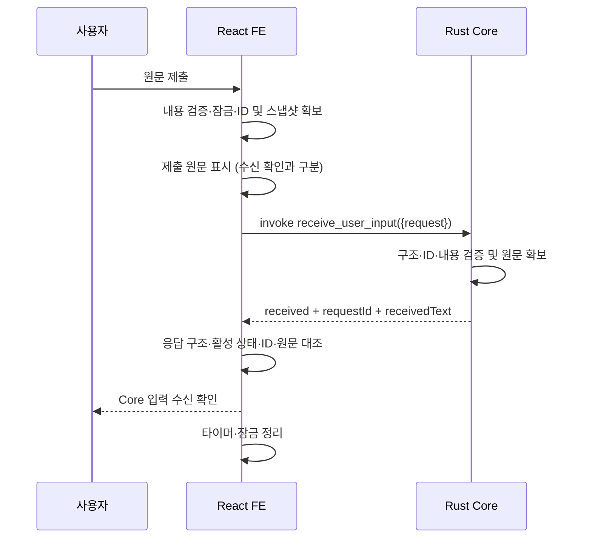

# User Input PoC — FE–Core IPC API Contract v0.1

- 문서 버전: v0.1
- 문서 상태: Draft
- 적용 대상: User Input PoC
- 통신 경계: React Frontend ↔ Tauri Rust Core
- 작성일: 2026-11-09 (Asia/Seoul)
- 대상 저장소: `C:\Users\user\JTK7458\Desktop\agent-orchestration`
- 조사 브랜치: `feat/user-input-ui` (브랜치 전환 없음)

## 1. 문서 개요

입력 원문이 실제 Rust Core까지 도달했음을 확인하기 위한 단일 IPC 계약이다. 구현 코드는 작성하지 않는다. 이 문서의 **제안**은 검토 가능한 계약 초안이며 승인된 프로젝트 결정이 아니다. 기존 코드에서 확인한 사실, 기존 요구사항, 이번 설계 제안을 구분한다.

### 근거 및 확인 범위

| 근거 ID | 자료 | 확인 결과와 한계 |
|---|---|---|
| E1 | 로컬 `src/`, `src-tauri/src/`, `tests/` | 2026-11-09 읽기 조사. 실행 및 테스트 재수행 안 함 |
| E2 | 로컬 `README.md`, `docs/architecture/fe-core-boundary.md`, `docs/poc/user-input/README.md`, `src/features/user-input/README.md` | 초기화 단계 설명이 남아 현재 입력 UI 코드와 불일치. IPC 계약은 미확정으로 명시 |
| E3 | `docs/poc/user-input/input-test-results.md` | 2026-11-08 검증 정책 및 58건 통과 기록 확인. 이번 작업의 실행 결과가 아님 |
| E4 | [상세기능 명세서](https://docs.google.com/spreadsheets/d/1c5geYDtLm2X5B9cZzp-b03OnzviUmuezXJ3GdCrov_I/edit) | Drive 읽기 결과 시트1의 34개 기능 확인. T-203은 미확인, T-204는 미응답 종료 후에도 제출 차단 해제 요구 |
| E5 | [프로젝트 개요](https://cprtmchzh.gitbook.io/orchestration) | 온라인 확인. 전체 제품의 Workflow 실행 목표와 이번 수신 전용 PoC를 구분 |
| E6 | 프로젝트 미러의 `analysis-references/06.-engineering__undefined.md` | 기술 스택·IPC 기본값 절 확인: React→Rust Command, Runtime 상태는 Channel. 온라인 하위 페이지 접근 실패로 사본 최신성은 미검증 |
| E7 | 프로젝트 미러의 `input-poc-decisions/Agent_Workspace_사용자_입력_PoC_확정사항_정의서_v0.1.md` | 승인 이력 없는 회의용 초안. schemaVersion/text, 16KiB, 3초 등은 미확정 권장안이며 이번 계약의 확정 근거로 사용하지 않음 |
| E8 | [Tauri 2 Calling Rust](https://v2.tauri.app/develop/calling-rust/), [Serde enum](https://serde.rs/enum-representations.html), [Serde field attributes](https://serde.rs/field-attrs.html) | 공식 기술 동작 확인. 프로젝트의 설계 승인 근거와는 별개 |

### 기존 구현 분석

| 분석 항목 | 판정 | 코드 근거 및 결론 |
|---|---|---|
| 입력창·입력·수정·삭제·버튼·제출 콜백 | 기존 구현 확인 | `UserInputForm.tsx`, `useUserInput.ts`; I-000~I-102 대응 코드 존재. 테스트 파일·이전 결과 존재 |
| 입력 상태 D-000 | 기존 구현 확인 | `useUserInput`의 `useState("")`, `setValue` |
| 제출 순간 값 확보 D-001 | 기존 구현 확인 | `handleSubmit`이 현재 `value`를 동기 콜백으로 전달 |
| 원문 보존 D-002 | 일부 구현 확인 | 검증 결과 문자열 대신 `value` 전달. 비동기 IPC 동안 유지할 요청 스냅샷은 없음 |
| 유효성 검사 D-100 | 기존 구현 확인 | `isValidUserInput.ts`; 이모지 제거 후 Unicode L/N 검사. 버튼과 직접 submit이 동일 `isValid` 사용 |
| 제출 경로 | 기존 구현 확인 | `App → MainPage → UserInputForm → useUserInput.handleSubmit → onSubmitText → MainPage.handleSubmittedText` |
| 요청 모델·ID D-101/D-102 | 미구현 | 요청 DTO와 ID 생성 없음. 현재 `(text: string) => void` 콜백만 존재 |
| T-000~T-204 | 미구현 | `src`에 invoke/transport 없음. 진행 상태·중복 차단·미응답 처리도 없음 |
| R-000~R-102 | 미구현 | `lib.rs`에 Builder 실행만 있음. command 및 invoke_handler 없음. `main.rs`는 run 진입만 담당 |
| O-000/O-001/O-101~O-103 | 미구현 | Core 결과 해석·연결·표시 없음 |
| O-100 | 미구현 | `MainPage`는 문자 수·줄 수만 표시하며 제출 원문 메시지를 표시하지 않음 |
| 재사용할 타입·래퍼 | 일부 구현 확인 | 입력 검증 함수·제출 콜백은 재사용 후보. 전송 DTO·래퍼는 없음 |
| Workspace 전체 UI·테마·관련 테스트 완료 | 확인 불가 | 현재 브랜치 파일에는 해당 구조 없음. 다른 브랜치의 내용은 조사·전환하지 않음 |

실제 설치 환경 전체를 실행해 재확인하지 않았다. 선언 및 lockfile 기준 React 19.2.9, TypeScript 5.9.3, Tauri JS API/CLI 2.12.4, Rust crate 2.12.3, Serde 1.0.229, Vite 8.3.6, Vitest 5.1.0, pnpm 10.34.9이다. `.nvmrc`는 Node 22.23.4, `rust-toolchain.toml`은 Rust 1.99.1을 지정한다.

## 2. 문서 버전 및 상태

v0.1 / Draft. `확정`은 기존 문서·명시적 사용자 요구 또는 실제 코드 근거가 있다는 뜻이며, 코드 관찰은 새 API 승인을 의미하지 않는다. `제안`은 본 초안의 권장 설계, `미결정`은 구현 전 합의가 필요한 항목이다. 이하 규범 문장은 명시된 기존 요구를 제외하면 **제안 계약을 채택할 경우** 적용한다. 변경 시 FE/Core 공동 검토와 공통 시나리오 갱신 후 버전을 올린다. payload에 schemaVersion을 추가하는 것은 이번 초안에 포함하지 않는다.

## 3. User Input PoC 목적

사용자가 제출한 원문을 실제 Core가 검증하고 수신한 결과를 FE에서 확인한다. 성공 조건은 요청 ID 일치, 유효한 응답 구조, Core 수신 원문과 제출 스냅샷의 완전 일치이다. 제출 메시지 표시, invoke 시작, Mock 응답은 실제 Core 수신 증거가 아니다. 자연어 의미 해석과 업무 수행은 성공 조건이 아니다.

## 4. API 적용 범위

포함: 입력 검증, 제출 스냅샷, ID 생성, IPC 요청·응답, Core 재검증, 결과 연결·무결성 검사, 상태·예외 표시. 제외: Agent/LLM/LangGraph/Workflow 실행, HTTP 서버, DB, 인증, 대화 영속화, 다중 Agent, 업무 자동화. 입력창 상세 UI는 I 영역 책임이며 계약은 UI의 배치나 스타일을 정의하지 않는다.

## 5. 시스템 및 통신 구조

`React 입력 → FE 검증 → 불변 요청 스냅샷 → invoke → Rust 역직렬화·검증 → 단일 응답 → FE 런타임 검증·대조 → 표시`.

이번 단건 수신에는 Command 하나로 충분하다. Event, Channel, HTTP, Sidecar를 추가하지 않는다. 이는 전체 제품의 Runtime 상태 전달 설계를 변경하지 않는다. 일반 웹 브라우저의 FE 실행만으로 실제 Tauri IPC를 검증할 수 없다.

## 6. API 기본 정보

| 항목 | 제안 계약 |
|---|---|
| API ID / 명칭 | IPC-001 / 사용자 입력 수신 |
| Command | `receive_user_input` |
| 호출 / 수신 | React Frontend / Tauri Rust Core |
| 방식 | Tauri IPC `invoke()`; 1요청 → 1응답 |
| 최상위 인수 | `{ request: UserInputRequest }` |
| 정상 resolve | `UserInputResponse`의 received 또는 rejected |
| 기술 오류 | Promise rejection; 정상 Response DTO를 보장하지 않음 |

현재 같은 이름의 Command가 없어 충돌은 발견되지 않았다. 등록은 `#[tauri::command]`와 Builder의 `.invoke_handler(tauri::generate_handler![receive_user_input])` 형태를 제안한다. 기존 등록 Command가 생기면 하나의 handler 목록에 합친다. 최상위 인수 `request`와 DTO 내부 camelCase는 서로 다른 변환 경계다. [Tauri 공식 문서](https://v2.tauri.app/develop/calling-rust/)

## 7. Request 명세

DTO 예시(실제 invoke 인수에서는 `request`로 감싼다):

```json
{
  "requestId": "550e8400-e29b-41d4-a716-446655440000",
  "rawText": "  안녕하세요! 😀  "
}
```

| 필드 | 타입·필수 | 허용 값·검증 | 생성 위치·시점 / 목적 | 오류 처리 |
|---|---|---|---|---|
| requestId | string, Y, null 불가 | 소문자 하이픈 포함 UUID v4. 정규 형태 `^[0-9a-f]{8}-[0-9a-f]{4}-4[0-9a-f]{3}-[89ab][0-9a-f]{3}-[0-9a-f]{12}$` | FE가 검증 통과 및 제출 잠금 확보 후 요청별 생성; 응답 연결 | 문자열이나 형식 오류는 rejected/INVALID_REQUEST_ID. 누락·타입 오류는 역직렬화 실패 경로 |
| rawText | string, Y, null 불가 | Unicode 문자열. 내용 조건은 §10. 길이 상한은 미결정 | 제출 순간 FE 상태의 원문을 복사; Core 수신 확인 | 문자열 내용 무효는 rejected/INVALID_INPUT. 누락·타입 오류는 역직렬화 실패 경로 |

추가 필드는 거부하는 제안이다(`deny_unknown_fields`). Request를 평탄화하거나 `raw_text`로 보내지 않는다. JSON 키 순서는 의미가 없다. 숫자→문자열 강제 변환, 기본값 대입, trim, 정규화, 줄바꿈 변환을 하지 않는다. 구조 오류는 문자열 ID가 있더라도 이 초안의 typed 인수 역직렬화 단계에서는 정상 응답을 보장하지 않는다.

## 8. Response 명세

```json
{
  "requestId": "550e8400-e29b-41d4-a716-446655440000",
  "status": "received",
  "receivedText": "  안녕하세요! 😀  "
}
```

```json
{
  "requestId": "550e8400-e29b-41d4-a716-446655440000",
  "status": "rejected",
  "errorCode": "INVALID_INPUT",
  "message": "유효한 문자 또는 숫자가 필요합니다."
}
```

| 필드 | received | rejected | 의미 |
|---|---|---|---|
| requestId: string | 필수 | 필수 | 수신한 요청 ID 문자열을 그대로 반환. ID 검증 실패 시에도 문자열 원값 반환 |
| status | `received` | `rejected` | 두 리터럴만 허용 |
| receivedText: string | 필수 | 포함하지 않음 | Core가 요청에서 확보한 원문. FE가 응답을 자체 합성하면 안 됨 |
| errorCode: string | 포함하지 않음 | 필수 | INVALID_INPUT 또는 INVALID_REQUEST_ID |
| message: string | 포함하지 않음 | 필수, 비어 있지 않음 | 사용자 안내용 고정 문구. 제어 로직은 code 사용 |

정상 응답은 두 형태 중 하나이며 다른 분기의 필드나 null을 넣지 않는다. 알 수 없는 status/code, 누락·추가 필드, 잘못된 타입은 FE의 RESPONSE_INVALID로 처리한다. INVALID_REQUEST_ID는 ID 형식 규칙의 예외로 **응답 ID의 UUID 유효성을 보장하지 않지만 원값 일치**를 보장한다. INVALID_INPUT은 유효 ID를 전제로 한다. ID와 내용이 동시에 잘못되면 ID 오류를 먼저 반환한다.

PoC의 receivedText는 원문 대조용이다. 화면에서는 텍스트로 렌더링하고 HTML·명령으로 실행하지 않는다. 원문을 콘솔, 분석 도구, 일반 로그, 기술 오류 메시지에 넣지 않는다. 제품에서 원문 전체 반환을 유지할지는 후속 결정이다.

## 9. TypeScript / Rust 데이터 타입 대응

아래는 문서 예시이며 실제 소스 파일을 생성하거나 현재 구현을 나타내지 않는다.

```typescript
type UserInputRequest = { requestId: string; rawText: string };
type UserInputResponse =
  | { requestId: string; status: "received"; receivedText: string }
  | { requestId: string; status: "rejected";
      errorCode: "INVALID_INPUT" | "INVALID_REQUEST_ID"; message: string };

// 전송 형식 예시. unknown을 검사한 후에만 UserInputResponse로 좁힌다.
import { invoke } from "@tauri-apps/api/core";
declare const request: UserInputRequest; // §7·§15에 따라 준비된 스냅샷
const candidate: unknown = await invoke<unknown>("receive_user_input", { request });
```

`invoke<UserInputResponse>`의 제네릭도 런타임 검증을 해 주지 않는다. `candidate`에 §8 검증 후 §15 대조를 적용하는 것이 계약이다.

```rust
use serde::{Deserialize, Serialize};

#[derive(Deserialize)]
#[serde(rename_all = "camelCase", deny_unknown_fields)]
struct UserInputRequest {
    request_id: String,
    raw_text: String,
}

#[derive(Serialize)]
enum RejectionCode {
    #[serde(rename = "INVALID_INPUT")]
    InvalidInput,
    #[serde(rename = "INVALID_REQUEST_ID")]
    InvalidRequestId,
}

#[derive(Serialize)]
#[serde(tag = "status")]
enum UserInputResponse {
    #[serde(rename = "received")]
    Received {
        #[serde(rename = "requestId")]
        request_id: String,
        #[serde(rename = "receivedText")]
        received_text: String,
    },
    #[serde(rename = "rejected")]
    Rejected {
        #[serde(rename = "requestId")]
        request_id: String,
        #[serde(rename = "errorCode")]
        error_code: RejectionCode,
        message: String,
    },
}
```

Serde의 내부 태그 enum으로 `status`와 각 variant의 필드를 같은 객체에 배치한다. 개별 rename으로 variant 이름과 내부 필드 이름을 명시하고 불필요한 Option/null을 피한다. [Serde enum](https://serde.rs/enum-representations.html), [field attributes](https://serde.rs/field-attrs.html)

Command 시그니처 제안은 `fn receive_user_input(request: UserInputRequest) -> Result<UserInputResponse, String>`이다(본문 생략). `Ok(Received { ... })`와 `Ok(Rejected { ... })`는 resolve, 예상하지 못한 기술 실패의 `Err(String)`은 reject로 대응한다. Err 문자열은 원문이나 내부 경로 없이 안전한 고정 설명으로 제한한다. 역직렬화·프레임워크 오류는 해당 문자열 형식을 보장하지 않으므로 FE catch 값은 unknown으로 다룬다. [Tauri 오류 반환](https://v2.tauri.app/develop/calling-rust/#error-handling)

## 10. 입력 데이터 유효성 검사 규칙

기존 FE 정책(E1/E3)과 이번 사용자 요구: **이모지 시퀀스를 검증용 문자열에서 제외한 뒤 Unicode General Category Letter(L) 또는 Number(N)가 하나 이상 남으면 허용**한다. 실제 rawText는 그대로 보낸다. FE는 버튼 제어 및 모든 제출 경로 방어, Core는 구조·ID·내용 재검증을 담당한다.

현재 FE의 검증용 제거 패턴은 다음과 같다. Rust에 그대로 복사할 구현 지시가 아니며 기존 동작의 기준 기록이다.

```text
[#*0-9]\uFE0F?\u20E3|[\p{Extended_Pictographic}\p{Emoji_Presentation}][\uFE0F\u200D\p{Emoji_Modifier}\u{E0020}-\u{E007F}]*
그 결과에 [\p{L}\p{N}] 존재 여부 검사
```

| 공통 fixture(이스케이프는 실제 해당 문자) | 기대 결과 |
|---|---|
| `""`, `"   "`, `"\t\n\r"`, `"!!!@#$"` | 거부 |
| `"😀"`, `"😀!!!"`, `"👍🏽"`, `"👨‍👩‍👧‍👦"`, `"🇰🇷"` | 거부 |
| `"1️⃣"`, `"1\u20E3"`, `"#️⃣"`, `"ℹ️"`, `"🅰️"` | 거부; 키캡 숫자·문자형 그림문자 잔여로 통과 금지 |
| `"안녕하세요"`, `"Hello"`, `"こんにちは"`, `"你好"` | 허용 |
| `"123"`, `"١٢"`, `"Ⅳ"` | 허용; ASCII 숫자에 한정하지 않음 |
| `"안녕😀"`, `"a!!!"`, `"1️⃣2"` | 허용 |
| `"  안녕\n세계 😀  "` | 허용, 공백·줄바꿈 포함 완전 보존 |
| `"\u0301"`, `"\u200D"`, `"\uFE0F"` | 거부; 결합 부호·연결자 단독 |
| `"e\u0301"`, `"é"`, `"한"` | 허용; NFC/NFD 등으로 변환하지 않음 |
| `"a\t\n"`, `"a\u0000"` | 현 L/N 규칙상 허용. 제어문자 추가 차단은 별도 변경 승인 필요 |

정상 이모지뿐 아니라 불완전 시퀀스·새 Unicode 문자·tag flag에 대해 두 언어의 테이블 버전과 분할 동작이 달라질 수 있다. Rust 라이브러리·Unicode 버전·완전한 fixture 집합은 미결정이며 구현 전 FE 결과와 대조한다. `ℹ`와 `ℹ️`처럼 문자 모양이라도 현재 제거 패턴의 그림문자에 속하면 거부될 수 있다. 이를 일반 문자로 재분류하도록 기존 FE를 임의 변경하지 않는다.

Rust String으로 표현할 수 없는 고립 UTF-16 surrogate를 가진 JS 문자열은 계약의 유효 Unicode 영역 밖이다. FE 검출·안내 정책과 별도 오류 코드는 미결정이다. 직렬화 단계 실패를 기술 오류로 처리하며 임의 U+FFFD 치환으로 수신 성공을 만들지 않는다.

입력 최대 길이·측정 단위(UTF-8 바이트/코드 포인트/grapheme)·초과 코드·FE/Core 적용 기준은 **미결정**이다. 무제한 보장을 뜻하지 않으며 기존 제안의 16KiB를 채택하지 않는다. `Array.from(text).length`는 현재 화면 집계일 뿐 API 제한 기준이 아니다.

## 11. 결과 및 오류 코드

| 계층·값 | 의미 | FE 상태 / 사용자 표시 |
|---|---|---|
| Core received | 내용 검증 및 원문 확보 | 무결성 확인 후 received / “Core가 입력을 수신했습니다.” |
| Core rejected / INVALID_INPUT | 구조는 맞지만 내용 불충족 | rejected / “유효한 문자 또는 숫자가 필요합니다.” |
| Core rejected / INVALID_REQUEST_ID | 문자열 ID 형식 오류 | rejected / “요청 식별자가 올바르지 않습니다.”; 시스템 문제로 안내 |
| FE IPC_ERROR | invoke 동기 예외 또는 Promise reject | error / “통신 중 오류가 발생했습니다. 수신 여부를 확인할 수 없습니다.” |
| FE RESPONSE_MISMATCH | 호출에 연결된 응답 ID가 원 ID와 다름 | error / “요청과 응답을 연결할 수 없습니다.” |
| FE RESPONSE_INVALID (추가 제안) | 응답 구조·분기·코드가 계약과 다름 | error / “응답 형식을 확인할 수 없습니다.” |
| FE RESPONSE_TEXT_MISMATCH (추가 제안) | ID는 맞으나 receivedText가 다름 | error / “수신 원문이 제출 내용과 일치하지 않습니다.” |
| FE RESPONSE_UNCONFIRMED | 기한까지 유효한 결과 미확인 | unconfirmed / “아직 Core 수신 결과를 확인하지 못했습니다.” |

추가 FE 코드는 Core errorCode에 넣지 않는다. FE 자체 내용 검증 실패는 IPC 없이 로컬 INVALID_INPUT 안내이며 Core가 거부했다고 표현하지 않는다. Core message는 코드 기반 고정 안내의 보조 정보이며 원문·stack·경로를 표시하지 않는다. 기술 오류는 Core 미수신의 증거가 아니다. malformed payload의 누락·null·타입 오류는 typed 인수 역직렬화 실패 → rejection → IPC_ERROR이며 INVALID_INPUT으로 가장하지 않는다.

## 12. 통신 상태 및 상태 전이

상태는 **제출 건별**로 관리한다. 새 제출은 기존 결과를 다른 요청의 결과로 덮어 쓰지 않는다. 입력 편집과 요청 스냅샷은 분리한다.

| 상태 | 의미·진입 | 종료·다음 상태 | 표시 / 재시도 |
|---|---|---|---|
| idle | 활성 제출 없음, 최초 상태 | 유효 제출 → sending. 로컬 무효 입력은 idle 유지 | 입력 가능 / 유효 입력 제출 가능 |
| sending | 잠금·스냅샷·ID 확보 후 invoke 시도 및 대기 | 올바른 received → received; 거부 → rejected; 기술·검증 오류 → error; 기한 경과 → unconfirmed | “전송 중” / 추가 제출 불가 |
| received | ID·원문까지 검증된 received | 새 제출 → 새 건 sending; 기존 건 결과 보존 | Core 수신 확인 / 새 ID로 재제출 가능 |
| rejected | 연결된 Core 검증 거부 | 입력 수정 후 새 제출 → 새 건 sending | 거부 사유 / 수정·새 ID 제출 가능 |
| error | 호출 오류·응답 오류·무결성 오류 | 정리 완료 후 새 제출 → 새 건 sending | 기술 오류 / 수동 새 제출 가능 |
| unconfirmed | 제한 시간까지 결과 확인 못함 | 이 초안 권장안에서는 해당 건 상태 유지; 새 제출 → 별도 건 sending | 미확인 및 중복 가능성 안내 / 수동 새 제출 허용 제안 |

종료 시 타이머와 FE 제출 잠금을 반드시 정리한다. 같은 제출 이벤트가 재진입해도 잠금 획득 전후 경계를 하나로 하여 요청 두 개가 만들어지지 않게 한다. React 렌더링상의 버튼 disabled만으로 중복 방지를 보장하지 않는다.

## 13. 중복 제출 정책

T-201의 대기 중 차단, T-204의 응답·오류·미응답 처리 후 차단 해제는 기존 요구다. **동시 FE 활성 대기 1개**, 자동 재시도 0회, 수동 제출마다 새 ID를 권장한다. 내용이 같아도 별도 제출이다. ID 생성 시 FE 보유 요청 기록과 충돌하면 새 ID를 생성하며 임의 재사용하지 않는다.

Core의 ID 중복 저장·중복 제거·멱등성·exactly-once 전달을 보장하지 않는다. 같은 ID가 다시 들어와도 현재 제안은 별도 수신·검증하며 기존 응답 캐시를 두지 않는다. FE가 timeout 후 잠금을 해제해도 이전 Core 실행은 남을 수 있으므로 Core 동시 실행 1개 보장은 아니다. 미확인 뒤 수동 재시도 허용·새 ID·안내 문구는 §20에서 승인할 제안이며 자동 재전송은 하지 않는다.

## 14. 타임아웃 및 미응답 처리

대기 제한 `T_wait` 값은 **미결정**, 초기 검토 후보는 **10초**다. 기존 E7의 3초도 확정값이 아니다. 승인 전 숫자를 합격 기준이나 운영 기본값으로 고정하지 않는다.

시작점 제안은 스냅샷·잠금 확보 후 invoke 직전의 단조 시각이다. invoke가 동기로 실패하면 즉시 IPC_ERROR. deadline 이전 결과가 먼저 처리되면 타이머를 해제하고 종료한다. deadline 이상에서 처리되는 결과는 늦은 결과로 분류한다. 경계 시점에는 요청별 종료 플래그로 단 한 번만 종결한다.

시간 초과는 unconfirmed/RESPONSE_UNCONFIRMED이며 실패나 거부가 아니다. FE 대기 제한이나 Promise.race는 Rust Command 취소를 뜻하지 않는다. 이 API에는 취소 명령이 없으며 실행 취소를 보장하지 않는다.

**늦은 응답 제안:** timeout으로 종결된 건은 terminal 상태를 유지하고 늦은 응답은 UI 상태 전이에 사용하지 않는다. 필요하면 원문 없는 진단 카운트만 기록한다. 새 요청 결과에 붙이지 않으며 늦은 rejection도 처리해 unhandled rejection을 남기지 않는다. “해당 요청의 늦은 정상 응답을 다시 반영”하는 대안은 미채택 제안으로, 팀이 선택하면 상태 전이와 테스트를 함께 변경한다. 재시도 시 같은 내용이 Core에 두 번 도달할 수 있음을 안내한다.

## 15. 요청 식별자 및 데이터 무결성

1. FE 검증 통과 후 제출 잠금을 획득하고 `requestId`와 `rawText`의 불변 스냅샷을 만든다. UUID v4 생성 주체는 FE, 후보 수단은 `crypto.randomUUID()`다. 생성 실패는 invoke 전 로컬 기술 오류로 처리하고 잠금을 해제한다.
2. 원문의 기준점은 **제출 순간 textarea/React 상태 문자열**이다. 입력기·붙여넣기·DOM에 들어오기 전 파일 바이트와의 일치를 약속하지 않는다. 제출 이후의 편집은 진행 요청을 바꾸지 않는다.
3. Core는 역직렬화된 request.raw_text 자체를 receivedText로 반환한다. trim·escape 재가공·Unicode 정규화·줄바꿈 변환을 하지 않는다.
4. FE는 먼저 §8 런타임 구조 확인, 다음 요청별 종결 여부, 응답 ID의 문자열 완전 일치, receivedText와 snapshot.rawText의 JS `===`를 검사한다. 비교 전 정규화하지 않는다. JSON escape 표기나 키 순서는 비교하지 않는다.
5. INVALID_REQUEST_ID 응답도 보낸 문자열 ID와 일치해야 한다. 일치하지 않으면 RESPONSE_MISMATCH가 우선한다. 구조 불량은 RESPONSE_INVALID, received 원문 불일치는 RESPONSE_TEXT_MISMATCH다.
6. invoke 호출별 closure에 원 요청을 연결한다. 응답 ID만 보고 다른 기록을 찾아 성공 처리하지 않는다. 비활성·종결 건과 새 건의 도착 순서가 바뀌어도 각자의 결과를 분리한다.

해시·정규화된 문자열·FE 자체 echo를 원문 검증의 대체 증거로 삼지 않는다. UUID의 이론적 충돌 가능성은 0이 아니며 분산 중복 제거 보장은 이번 범위 밖이다.

## 16. 정상 처리 시퀀스



## 17. 예외 처리 시퀀스

| 경로 | 처리 순서 및 종료 |
|---|---|
| FE 내용 무효 | 제출 이벤트 → 로컬 검증 거부 → invoke/ID 생성 없음 → 입력 수정 안내 |
| Core 내용 무효(우회 호출 포함) | 역직렬화 성공 → ID 통과 → 내용 실패 → Ok(rejected/INVALID_INPUT) → FE ID 대조 후 rejected |
| ID 형식 무효 | 역직렬화 성공 → ID 실패 → 원 문자열 ID로 Ok(rejected/INVALID_REQUEST_ID) → FE 연결 확인 후 rejected |
| request/rawText 누락·타입 오류 | Tauri 인수/Serde 단계 실패 → Promise reject → FE IPC_ERROR → error 및 잠금 해제 |
| Command 미등록·호출 불가 | invoke reject 또는 동기 예외 → IPC_ERROR → error; 수신 여부 단정 금지 |
| 응답 구조·ID·원문 오류 | resolve → 런타임 검증/대조 실패 → 해당 FE 오류 → 성공 표시 금지 → 정리 |
| 무응답 | deadline 도달 → unconfirmed → 잠금 해제 → 늦은 응답은 해당 종결 건에 반영하지 않음 |
| 재시도 후 이전 응답 도착 | 새 ID 요청 시작 → 이전 closure의 종결 플래그로 무시 → 새 요청의 대기는 계속 |

구조 오류에서도 항상 정상 DTO를 요구하는 방식은 이 초안에 없다. 이를 요구하면 typed 인수 이전의 수동 파싱 설계와 오류 DTO를 별도로 검토해야 한다.

## 18. 상세기능 ID 매핑

아래 34개 ID를 모두 포함한다. 규칙 ID는 문서 추적용이며 추가 API를 뜻하지 않는다.

| API 규칙 ID | 정의 항목·관련 절 | 관련 기능 ID | 계약 연결 및 책임 |
|---|---|---|---|
| API-001 | 입력 UI 경계 §4 | I-000, I-001, I-002, I-100 | UI 내부 동작. IPC 필드·Command와 직접 대응하지 않음 |
| API-002 | 제출·스냅샷 §7,15 | I-101, I-102, D-001 | I는 UI 이벤트 전달, D부터 요청 계약에 직접 연결 |
| API-003 | 상태·원문 보존 §7,15 | D-000, D-002 | 입력 상태는 FE 내부, 제출 스냅샷은 계약의 rawText 기준 |
| API-004 | FE 검증 §10,11 | D-100, O-102 | 무효 제출 로컬 차단 및 거부 표시; Core 수신과 구분 |
| API-005 | Request 생성 §7 | D-101 | request 래퍼 및 DTO 구성 |
| API-006 | ID·연결 §15 | D-102, O-001 | 요청마다 새 ID, 요청별 원문 연결·응답 대조 |
| API-007 | Command 정의 §5,6,9 | T-000, T-001, R-000 | invoke 대상 및 Core 등록 계약 |
| API-008 | 송수신 §8,16 | T-100, T-101, T-102, R-001 | 전송·대기·Core 수신·응답 전달 |
| API-009 | 상태·중복 제어 §12,13 | T-200, T-201, T-204 | FE 내부 상태가 계약 생명주기를 제어 |
| API-010 | 기술 오류 §11,17 | T-202, O-103 | Promise reject와 검증 거부 구분 |
| API-011 | 미응답 §14 | T-203, T-204, O-103 | 미확인·늦은 응답·제출 상태 복구 |
| API-012 | 구조·내용 검증 §7,10 | R-002, R-100 | 역직렬화 실패 경로와 내용 거부 경로 분리 |
| API-013 | 수신·결과 생성 §8,15 | R-101, R-102 | Core 원문 echo 및 결과 분기 생성 |
| API-014 | 응답 해석 §8,11,15 | O-000, O-001 | 런타임 구조 검증·ID·원문 대조 |
| API-015 | 화면 출력 §11,12 | O-100, O-101, O-102, O-103 | UI 표현 자체는 FE 내부, 표시 근거·성공 의미는 계약에서 규정 |

D 6개, T 10개, R 6개, O 6개는 데이터·통신·수신·결과 책임으로 계약에 연결된다. I 6개 중 I-000/001/002/100은 UI 내부, I-101/102는 계약 직전 제출 경계다. 매핑은 완료 판정이 아니며 구현 현황은 §1을 따른다.

## 19. API 검증 시나리오

**테스트 명세만 작성하며 이번 작업에서 실행하지 않았다.** 일반 입력·FE 차단은 UI 경로, Core 거부·구조 오류는 FE 검증을 우회한 실제 invoke 경로, 응답 변조·시간 경계는 제어 가능한 시험 대역에서 검증한다. 실제 Rust 수신 성공 증명은 별도의 실앱 IPC 시험이 필요하다. 아래 `T_wait`는 승인할 값이다.

| 테스트 ID | 입력 조건 | 기대 결과 | 관련 기능 ID |
|---|---|---|---|
| API-T01 | 한글 `안녕하세요` / 유효 UUID | received, ID·원문 완전 일치 | D-101,T-100,R-101,O-101 |
| API-T02 | 영문 `Hello` | received, 원문 일치 | D-100,R-100,O-101 |
| API-T03 | `こんにちは`, `你好`, 혼합 다국어 | 각각 received | D-100,R-100,O-101 |
| API-T04 | `123`, `١٢`, `Ⅳ` | 각각 received | D-100,R-100 |
| API-T05 | `  안녕  ` | 앞뒤 공백 보존 | D-001,D-002,R-101,O-100 |
| API-T06 | `안녕\n세계\t` | 줄바꿈·탭 보존 | D-002,R-101,O-101 |
| API-T07 | `a😀!`, `1️⃣2` | received; 검증용 제거가 원문에 영향 없음 | D-100,R-100,R-101 |
| API-T08 | 요청과 응답의 ID 동일 | 해당 제출에만 연결 | D-102,O-001 |
| API-T09 | `e\u0301`, `é`, 분해 한글 | 각각 허용; 정규화 없이 원문 대조 | D-002,R-101,O-001 |
| API-T10 | 빈 문자열 | FE 차단/invoke 0회; 우회 시 INVALID_INPUT | D-100,R-100,O-102 |
| API-T11 | 공백 / 탭·줄바꿈 전용 | FE 차단; 우회 시 INVALID_INPUT | D-100,R-100 |
| API-T12 | 특수문자 전용 / 기호+이모지 | FE 차단; 우회 시 INVALID_INPUT | D-100,R-100 |
| API-T13 | 😀 / 👍🏽 / ZWJ 가족 / 국기 | 각각 거부; FE/Core 동일 | D-100,R-100 |
| API-T14 | `1️⃣`, `1\u20E3`, `#️⃣`, `ℹ️`, `🅰️` | 각각 거부; 숫자·문자 잔여 오판 없음 | D-100,R-100 |
| API-T15 | 결합 부호·ZWJ·VS 단독 | 거부 | D-100,R-100 |
| API-T16 | ID `bad-id`, 빈 ID, 대문자 UUID, v1 UUID | 문자열 원값 ID로 rejected/INVALID_REQUEST_ID | D-102,R-002,R-102,O-102 |
| API-T17 | 잘못된 문자열 ID + 무효 내용 | ID 오류 우선 | R-002,R-100,R-102 |
| API-T18 | request 또는 필수 필드 누락 | Promise reject → IPC_ERROR; 정상 DTO 보장 없음 | T-202,R-002,O-103 |
| API-T19 | request=null/배열, rawText=123/null, requestId=123/null | 각각 역직렬화 실패 → IPC_ERROR | R-002,T-202 |
| API-T20 | DTO에 추가 필드 또는 raw_text 키 | 구조 거부 → IPC_ERROR | D-101,R-002 |
| API-T21 | 존재하지 않는 Command | IPC_ERROR; 수신 성공 표시 없음 | T-001,T-202,O-103 |
| API-T22 | invoke 동기 예외 / Promise rejection | error; 타이머·잠금 해제; 원문 로그 없음 | T-202,T-204,O-103 |
| API-T23 | 응답이 T_wait 이전에 도착 | 응답 검증 후 정상 종료, 미확인 표시 없음 | T-101,T-102,T-203 |
| API-T24 | 응답 없음 / T_wait 경과 | unconfirmed; 미수신 단정 금지; 제출 잠금 해제 | T-203,T-204,O-103 |
| API-T25 | 같은 호출에서 다른 ID 반환 | RESPONSE_MISMATCH; 다른 요청에도 연결 금지 | O-001,O-103 |
| API-T26 | null 응답, 미지원 status/code, 누락·추가·잘못된 타입 | RESPONSE_INVALID; 성공 표시 금지 | O-000,O-103 |
| API-T27 | ID 동일·receivedText만 다름 | RESPONSE_TEXT_MISMATCH | D-002,R-101,O-001,O-103 |
| API-T28 | timeout 후 늦은 정상·거부·reject | 종결 상태 유지; unhandled rejection 없음 | T-203,O-001,O-103 |
| API-T29 | sending 중 클릭·직접 submit 연속 호출 | ID/요청 1개; 중복 invoke 없음 | I-101,T-200,T-201 |
| API-T30 | received/rejected/error/unconfirmed 각각 종료 | 잠금 해제; 다음 유효 제출 가능 | T-204 |
| API-T31 | 미확인 뒤 새 제출 후 이전 응답이 먼저/나중 도착 | 새 ID, 새 건에 이전 결과 반영 안 됨 | D-102,T-203,O-001 |
| API-T32 | 전송 중 입력값 변경 | 기존 스냅샷·표시 원문·대조 기준 불변 | D-001,D-002,O-100 |
| API-T33 | UUID 생성기가 보유 ID와 충돌 | 새 ID 생성; 충돌 ID로 invoke 안 함 | D-102 |
| API-T34 | deadline 경계에서 응답·타이머 경합 | 처리 시각이 deadline 이상이면 미확인; 한 번만 종결 | T-200,T-203,T-204 |
| API-T35 | `a\u0000` | 현 정책상 허용·원문 보존; 화면 안전 출력 | D-100,R-100,R-101 |
| API-T36 | 고립 surrogate 포함 문자열 | 정상 성공 금지; 표현 불가 오류 경로 확인. FE 사전 안내는 TBD | D-002,T-202,O-103 |
| API-T37 | 최대 길이 경계·초과 | 정책 승인 전 기대값 보류, 임의 상한 시험 통과 주장 금지 | D-100,R-100 |
| API-T38 | 잘못된 ID rejected 응답의 ID 일치 | UUID 형식 재검사로 연결을 막지 않고 rejected 표시 | R-102,O-001,O-102 |
| API-T39 | 제출 원문·결과 UI 관찰 | 제출 표시는 수신 성공과 구분; Agent 실행 성공 표현 없음 | O-100,O-101 |

§10 fixture는 FE와 Core에서 동일하게 사용하는 공통 검증 목록이다. 기대 결과가 서로 다르면 Rust 쪽만 임의 완화하지 말고 정책·테이블·fixture를 함께 검토한다. 로그에는 합성 입력만 사용해도 불필요한 원문 자동 기록은 피한다.

## 20. 결정사항 및 미결정 사항

| 결정 ID | 항목 | 권장안 / 현재 사실 | 상태 | 근거 |
|---|---|---|---|---|
| API-DEC-01 | Command 이름 | receive_user_input | 제안 | 기존 이름 없음, 사용자 초안 |
| API-DEC-02 | Request | requestId, rawText; request 래퍼 | 제안 | 최소 수신 계약. E7의 text/schemaVersion은 미승인 다른 초안 |
| API-DEC-03 | ID | FE UUID v4, 제출별 신규, 소문자 표준형 | 제안 | 연결·충돌 방지 |
| API-DEC-04 | 정상 상태 | received | 제안 | E4의 수신 확인 요구 구체화 |
| API-DEC-05 | 검증 거부 | rejected + 2개 코드 | 제안 | 내용·ID 오류 분리 |
| API-DEC-06 | 원문 반환 | receivedText 포함 | 제안 | PoC 완전 일치 검증 |
| API-DEC-07 | 기존 문자 정책 | 이모지 제외 후 L/N 존재, 원문은 무변환 | 확정(기존 FE·이번 요구) | E1/E3; Core 구현은 없음 |
| API-DEC-08 | 대기 중 중복 차단·종료 후 복구 | 전송·대기 중 차단; 미응답 종료도 해제 | 확정(요구) | E4 T-201/T-204; 코드 미구현 |
| API-DEC-09 | 타임아웃 수치 | T_wait 미정, 10초 후보 | 미결정 | E7의 3초도 미승인; 측정·OS 검토 필요 |
| API-DEC-10 | ID 불일치 | 성공 금지 | 확정(요구) | E4 O-001 및 이번 요구. 코드명은 제안 |
| API-DEC-11 | 입력 최대 길이 | 단위·상한·초과 처리·양측 적용 | 미결정 | 확정 근거 없음 |
| API-DEC-12 | 문서 버전·상태 | v0.1 Draft | 확정(이번 산출물) | 사용자 지정 |
| API-DEC-13 | 구조 오류·기술 오류 | typed Deserialize, reject, FE IPC_ERROR | 제안 | Tauri/Serde 경계와 일치 |
| API-DEC-14 | 추가/누락/null 필드 | unknown 거부, 필수 string; 정상 DTO에 null 없음 | 제안 | 명확한 단일 버전 계약 |
| API-DEC-15 | 응답 런타임 검증 | RESPONSE_INVALID / RESPONSE_TEXT_MISMATCH 추가 | 제안 | O-000 및 무결성 검증 구체화 |
| API-DEC-16 | 재시도·전달 보장 | 자동 0회, 수동 새 ID, Core 중복 제거 없음 | 제안 | T-204 복구 후 중복 가능성 명시 |
| API-DEC-17 | 늦은 응답 | timeout 건 terminal 유지, UI 미반영 | 제안 | 응답 역전·새 건 오연결 방지 |
| API-DEC-18 | Unicode 구현 동등성 | 테이블 버전·이모지 인식 범위·Rust 수단 | 미결정 | 정규식 문법 복사로 동일성 보장 불가 |
| API-DEC-19 | 비정상 Unicode | 고립 surrogate 사전 차단·안내 방식 | 미결정 | JS/Rust 문자열 표현 차이 |
| API-DEC-20 | 전송 후 입력창 UX | 편집 허용 여부·성공 후 초기화·결과 표시 유지 기간 | 미결정 | 스냅샷 독립성만 본 계약에서 요구 |
| API-DEC-21 | IPC 기본 방향 | React→Rust Command | 확정(사본의 기본값) | E6; 온라인 하위 페이지 최신성 확인 필요 |

### 구현 전 합의할 항목

FE/Core는 01~06, 13~17의 DTO·오류·ID·재시도·늦은 응답 제안을 검토하고, 09/11/18/19/20의 TBD를 결정한다. 최대 크기·고립 surrogate 안내는 현재 예시 코드만으로 완결되지 않는다. Unicode 공통 fixture, T_wait 측정 경계, 실앱 시험 OS·허용 시간 오차도 합의해야 한다. 승인 기록은 `결정 ID / 최종 문구 / 승인자 / 승인일 / 근거 버전`으로 추가한다. 현재 승인 기록은 없다.

## 21. 구현 시 주의사항

- 현재 README들의 미구현 설명과 실제 I/D 코드가 다르다. 이번에는 기존 문서를 변경하지 않았으며 후속 정비 대상이다.
- 사용자 설명의 Workspace·테마 완료와 달리 현재 브랜치는 입력 UI만 확인된다. 기능 완료를 현재 코드에 추정 적용하지 않는다.
- 기존 E7 초안의 schemaVersion/text·3초·16KiB와 본 초안은 다르지만 모두 미승인 제안이다. 본 문서가 기존 승인을 대체했다고 주장하지 않는다.
- TS 타입, Rust snake_case, JSON camelCase, 최상위 request 래퍼를 혼동하지 않는다. Rust enum의 직렬화 결과를 두 응답 예시와 대조한다.
- 기술 오류 catch 값은 Error 인스턴스나 일정한 객체라고 가정하지 않는다. framework 오류 문자열을 파싱해 비즈니스 코드를 만들지 않는다.
- 응답 성공 표시 전 구조·ID·원문을 모두 확인한다. rejected를 Rust Err에 넣지 않는다.
- FE/Core 중복 검증은 필요하다. FE의 정규식과 Rust의 Unicode 데이터·이모지 분할 차이는 통합 전에 해결한다.
- 타임아웃 처리 후에도 Core 작업과 Promise가 남을 수 있다. 새 건과 이전 건의 closure·타이머·결과를 분리한다.
- 기존 Tauri 호출 권한·window 설정을 구현 시 확인한다. 이번 문서는 권한 설정·패키지·소스·테스트를 수정하지 않는다.
- E3의 58건 통과는 이전 입력 테스트 기록이며 IPC 검증 통과가 아니다. 이번에는 API 테스트 명세만 작성했다.

Git 조사 시 기존 미추적 `docs/vscode-mcp.md`, `scripts/open-vscode-mcp.cmd`가 있었다. 두 파일을 보존하고 브랜치 전환·merge·rebase·commit·push를 수행하지 않는다. 이번 변경 대상은 이 계약서 한 파일이다.

## 22. 향후 확장 고려사항

실제 제품 단계에서 원문 반환 축소, 명시적 계약 버전, 중복 제거, 취소, 대용량 입력, 저장 및 보관 기한을 별도 계약으로 검토할 수 있다. Agent·Workflow·Session API와 이벤트 스트림은 이번 수신 PoC에 추가하지 않는다. 확장 시 승인된 DTO·오류·Unicode fixture·기능 매핑·테스트 기대값을 함께 갱신한다.
